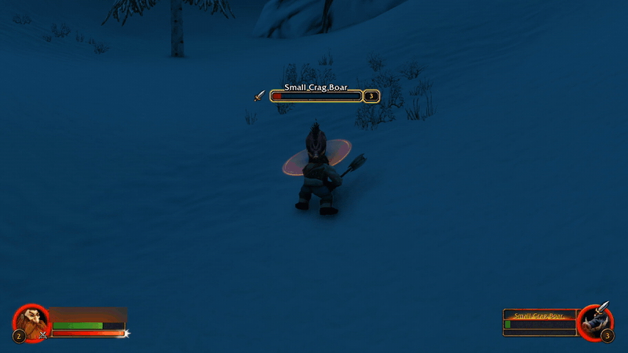
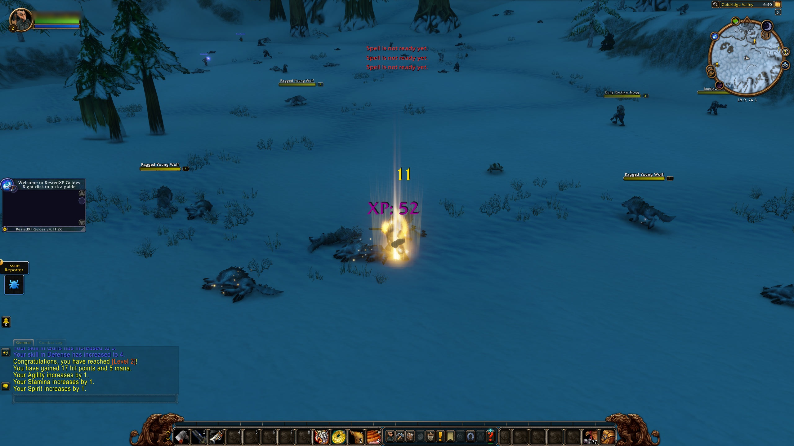
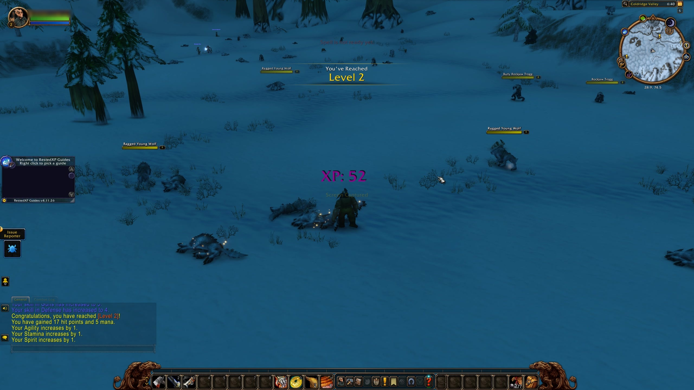
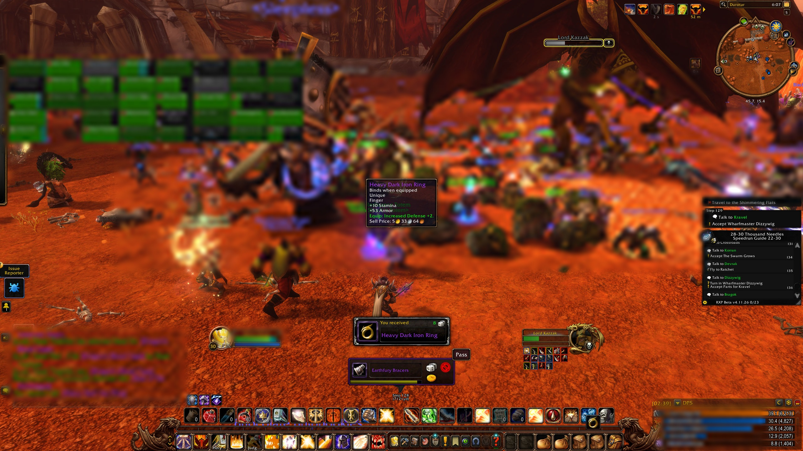

# DingCam

**Your WoW Forever journey, recorded automatically.** Every level-up, boss kill, rare kill, epic drop and new zone is saved as a video clip or screenshot, then filed by character, without you pressing anything.

*Video clips come from a small open-source companion app that runs on your PC (see [How it works](#how-it-works)). The addon on its own saves screenshots.*



*The clip DingCam saved on its own at a level 3 ding ([full 10-second clip](media/ding.mp4)).*

| The golden glow | The banner | A loot flash mid-raid |
|---|---|---|
|  |  |  |

```
DingCam Journey\
  Level-ups\Grimbold\Level 30 - The Barrens - 3d 19h played - 2026-11-05 21-14.mp4
  Banner\Grimbold\Level 30 - The Barrens - 3d 19h played - 2026-11-05 21-14.jpg
  Bosses\Grimbold\Edwin VanCleef - The Deadmines - 2026-11-06 22-40-12.mp4
  Loot\Grimbold\Bonereaver's Edge - Molten Core - 2026-12-02 23-05-51.jpg
  Zones\Grimbold\Durotar - Level 05 - 2026-11-04 18-22.jpg
```

## What it captures

| Moment | What you get |
|---|---|
| **Level-up** | A video clip of the ding, a screenshot of the golden glow, and one of the "You've Reached Level N" banner. Each is named with the zone and your /played time. |
| **Level 60** | At 59 DingCam reminds you to lengthen Instant Replay. Your 60 ding then gets a longer clip that keeps rolling through the celebration. |
| **Boss kill** | A clip and a screenshot. |
| **Rare kill** | A clip and a screenshot, for rares that die while tagged to you. |
| **Epic and rare loot** | The item's tooltip flashes mid-screen for a split second and is screenshotted. This covers blue and purple Bind-on-Equip drops in the world, and any blue or purple you receive in a dungeon or raid. |
| **New zone** | A screenshot the first time each character enters a zone. |

Your own screenshots (Print Screen) are never moved, renamed or deleted.

## How it works

DingCam has two parts:

1. **The addon** (in game) notices the moment and takes a screenshot, using only WoW's normal screenshot feature.
2. **The helper** (a small background program on your PC) sees that screenshot appear and, a few seconds later so the moment is inside the clip, saves a clip with your recorder: **NVIDIA** or **AMD** Instant Replay (by pressing its save hotkey) or **OBS**'s Replay Buffer (through OBS's own WebSocket, on your PC only). When you log out or `/reload`, it files everything by character.

Without the helper, the addon still works, but you get screenshots only, no clips. It will tell you so.

## Requirements

- Windows 10 or 11
- World of Warcraft: Forever
- One recorder for the clips. A replay length of 30 seconds or more is recommended.
  - **NVIDIA:** the NVIDIA app (or GeForce Experience) with **Instant Replay on**: `Alt+Z` > Instant Replay > On.
  - **AMD:** AMD Software: Adrenalin with **Instant Replay on**: `Alt+R` > Record & Stream > Instant Replay. *(AMD support is new and not yet tested on AMD hardware; reports welcome.)*
  - **OBS Studio 28 or newer:** the **Replay Buffer** enabled (Settings > Output) and started, and the **WebSocket server** on (Tools > WebSocket Server Settings). DingCam reads OBS's port and password from OBS's own settings.

DingCam picks the recorder for you: OBS while it's open with its Replay Buffer running, otherwise your graphics card's Instant Replay. You can force one with the `Recorder` setting.

## Install

1. **Addon:** install **DingCam** from CurseForge, or copy the `addon\DingCam` folder from the download into `World of Warcraft\_forever_\Interface\AddOns`.
2. **Helper:** download the latest release from the [Releases page](https://github.com/Holmstien/DingCam/releases), unzip it, and double-click **`Install DingCam`**. No admin rights are needed. It:
   - installs the helper for your Windows account,
   - sets it to start when you sign in,
   - finds your WoW folder and your recorder (NVIDIA, AMD or OBS) on its own,
   - and shows a short report of anything you need to fix.
3. **Check in game:** type `/dingcam status`, then `/dingcam test` to save a test clip. After a `/reload`, it appears in `Videos\DingCam Journey`.

Windows may warn about running a downloaded script. The helper is plain PowerShell you can read (`helper\DingCam-Helper.ps1`). It never connects to the internet; the only connection it ever makes is to OBS on your own PC, if you use OBS.

## Commands

| Command | Does |
|---|---|
| `/dingcam status` | Is the helper running? Which recorder, and is it on? |
| `/dingcam test` | Saves a test ding (clip plus screenshots), named `TEST ...` |
| `/dingcam boss` / `rare` | Test a boss or rare kill clip |
| `/dingcam loot` | Test the loot flash with your equipped weapon |
| `/dingcam zone` | Retake the first-visit shot for this zone |
| `/dingcam warn` | Preview the "recorder is off" warning |
| `/dingcam remind` | Turn helper reminders back on, if you clicked "Don't remind me" |

## Settings

The helper finds everything automatically. To change something, edit `%APPDATA%\DingCam\settings.json` and run `Install DingCam` again:

| Setting | Empty means |
|---|---|
| `WowFolder` | Found through Battle.net |
| `JourneyFolder` | `Videos\DingCam Journey` |
| `Recorder` | Automatic: `obs` while OBS is open with its Replay Buffer running, otherwise `nvidia` or `amd` |
| `ClipFolder` | The recorder's own folder: NVIDIA's setting, `Videos\Radeon ReLive` for AMD (OBS reports its files itself) |
| `SaveHotkey` | NVIDIA's own "save Instant Replay" shortcut (usually `Alt+F10`), or AMD's `Ctrl+Shift+S` |
| `ObsPort`, `ObsPassword` | Read from OBS's WebSocket settings |

The log is at `%LOCALAPPDATA%\DingCam\dingcam.log`.

## Uninstall

Double-click **`Uninstall DingCam`**. It stops the helper and removes it from startup. Your Journey folder is never touched. Remove the addon in CurseForge or by deleting its folder.

## FAQ

**Is this allowed?** The addon only uses WoW's own screenshot function. The helper runs outside the game: it watches your Screenshots folder and asks your recorder to save a clip. It doesn't read or change the game, and doesn't automate any gameplay.

**Does it slow my game?** The helper mostly sleeps. Instant Replay and OBS's Replay Buffer have a small cost of their own, the same as using them without DingCam.

**Do clips take double the space?** No. If your Journey and the recorder's folder are on the same drive, the clip is filed as a link to the same file.

**I use OBS and an NVIDIA/AMD card. Which one records?** OBS, whenever it's open with its Replay Buffer running. Otherwise your card's Instant Replay. Set `Recorder` to choose one yourself.

---
Made by **Holmstein** (built with Claude) for WoW Forever, Nov 2026. Released under the [MIT License](LICENSE).
